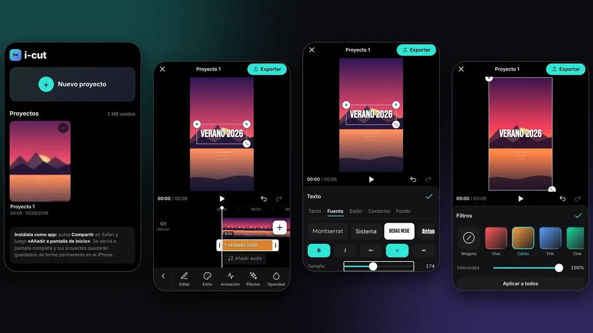
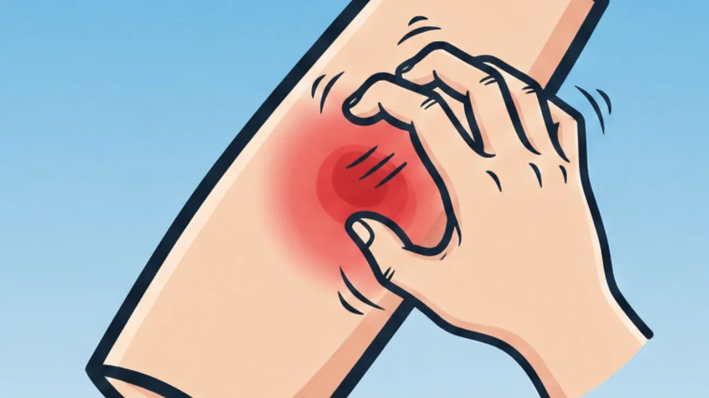
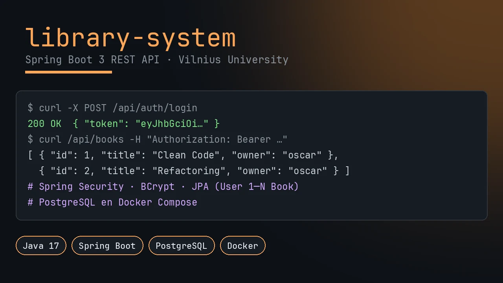
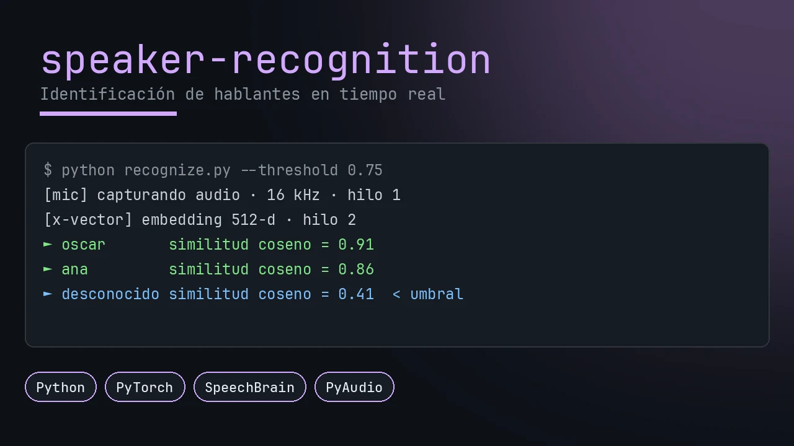
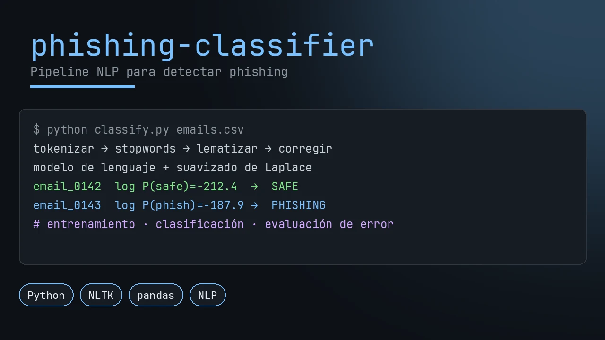
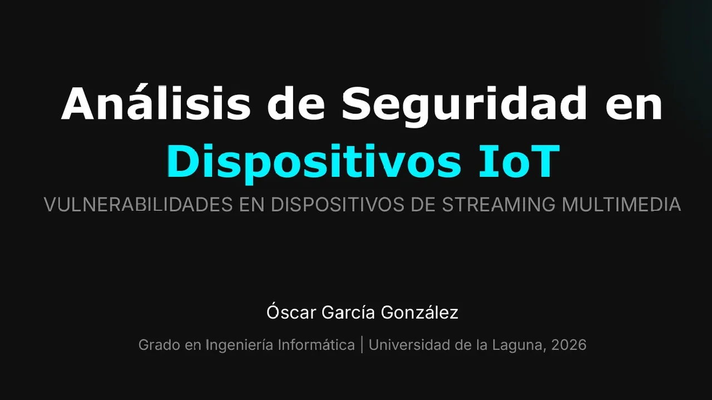
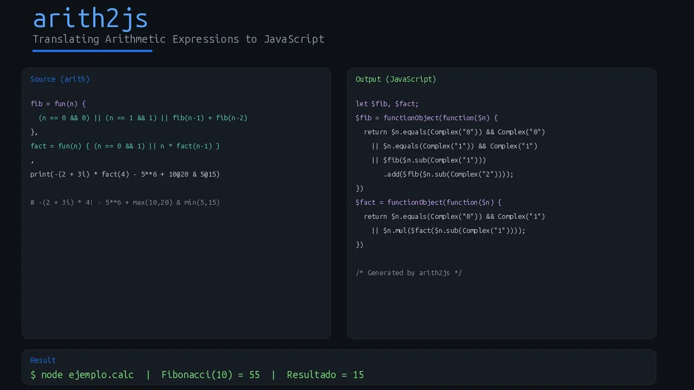

<!-- Cabecera -->

  

  

  
  
  

---

<table>
  <tr>
    <td width="30%" align="center" valign="middle">
      
    </td>
    <td width="70%" valign="middle">

### 👋 ¡Hola! Soy Óscar

Ingeniero Informático por la **Universidad de La Laguna (ULL)**, desde Tenerife. Me gusta construir aplicaciones completas: **web full-stack, apps móviles y de escritorio**, y cada vez más, soluciones con **inteligencia artificial**.

- 🏢 **Ahora:** en el **ITER** (Instituto Tecnológico y de Energías Renovables), trabajando en **análisis de datos, IA y monitorización**.
- 🎓 **Formación:** Grado en Ingeniería Informática (ULL, 2021 – 2026) + Erasmus en **Vilnius University** 🇱🇹.
- 💼 **Antes:** Full-Stack Developer en **DISA** (2026).
- 🧠 **Me interesa:** arquitectura de software, rendimiento y optimización de sistemas, y planificación automática (**PDDL**).
- 🌍 **Idiomas:** español (nativo), inglés (B2 Cambridge), alemán (A1).

</td>
  </tr>
</table>

---

## 🎯 En qué me enfoco

<table>
  <tr>
    <td width="33%" valign="top">
      <h3 align="center">🌐 Full-Stack</h3>
      
APIs REST con <b>Node.js</b>, <b>C# .NET Minimal APIs</b> y <b>Spring Boot</b>, interfaces con <b>React / Next.js</b> y datos en <b>PostgreSQL</b>.

    </td>
    <td width="33%" valign="top">
      <h3 align="center">📱 Móvil y escritorio</h3>
      
Apps multiplataforma con <b>React Native + Expo</b> y <b>Supabase</b>, y apps web instalables (<b>PWA</b>) que aprovechan la GPU del dispositivo.

    </td>
    <td width="33%" valign="top">
      <h3 align="center">🤖 IA y datos</h3>
      
Deep learning, NLP y aprendizaje por refuerzo con <b>Python</b>, <b>PyTorch</b> y <b>scikit-learn</b>; análisis y monitorización de datos.

    </td>
  </tr>
</table>

---

## 🚀 Proyectos destacados

<table>
  <tr>
    <td colspan="2" valign="top">
      
      <h3>🎬 i-cut · Editor de vídeo para iPhone</h3>
      
Editor de vídeo gratuito que se instala desde Safari como app (PWA) y funciona sin conexión. Todo se edita y se exporta dentro del iPhone, hasta 4K: composición por GPU con <b>WebGL2</b>, codificación por hardware con <b>WebCodecs</b> y <b>subtítulos automáticos con IA</b> (Whisper en el propio dispositivo). Incluye línea de tiempo táctil, keyframes, curvas de velocidad, estabilización, 15 filtros, 13 efectos, 12 transiciones y eliminación automática de silencios y muletillas. Sin cuenta, sin marcas de agua y sin subir nada a internet.

      
<a href="https://i-cut.vercel.app"><b>▶️ Probar la app</b></a> · <a href="https://github.com/Oscarggs05/i-cut"><b>📂 Ver el código</b></a>

      
      
      
      
      
      
      
    </td>
  </tr>
  <tr>
    <td width="50%" valign="top">
      
      <h3>📱 DermaTracker</h3>
      
App móvil (iOS y Android) para el seguimiento de la dermatitis: 8 widgets con gestos <i>swipe-to-save</i>, onboarding con más de 30 alérgenos y backend con seguridad a nivel de fila.

      
      
      
      
    </td>
    <td width="50%" valign="top">
      
      <h3>🌐 Library Management System</h3>
      
API REST full-stack desarrollada en el Erasmus: autenticación con Spring Security y BCrypt, JPA con relaciones Usuario–Libro y PostgreSQL en Docker.

      
      
      
      
    </td>
  </tr>
  <tr>
    <td width="50%" valign="top">
      
      <h3>🤖 Speaker Recognition</h3>
      
Identificación de hablantes en tiempo real con embeddings x-vector de SpeechBrain, similitud coseno y procesamiento de audio multihilo.

      
      
      
    </td>
    <td width="50%" valign="top">
      
      <h3>🤖 Phishing Email Classifier</h3>
      
Pipeline de NLP que clasifica correos como phishing o seguros: tokenización, lematización y modelo de lenguaje con suavizado de Laplace.

      
      
      
    </td>
  </tr>
  <tr>
    <td width="50%" valign="top">
      
      <h3>🎓 TFG · Seguridad en dispositivos IoT</h3>
      
Análisis de vulnerabilidades en Chromecast y Fire TV en un entorno controlado, con una guía de mitigación para fabricantes y usuarios.

      
      
      
    </td>
    <td width="50%" valign="top">
      
      <h3>⚙️ Arith2JS</h3>
      
Transpilador de un lenguaje aritmético propio a JavaScript: gramática con Jison, AST, generación de código y CI con GitHub Actions.

      
      
      
    </td>
  </tr>
</table>

  <a href="https://oscargarciagonzalez.vercel.app/"><b>👉 Ver todos los proyectos en mi portfolio</b></a>

---

## 🛠️ Tecnologías

**🌐 Full-Stack**

**📱 Móvil y escritorio**

**🤖 IA y datos**

**🗄️ Datos, infraestructura y herramientas**

---

## 📫 Hablemos

¿Tienes un proyecto interesante o una oportunidad? Escríbeme.

  
  
  

